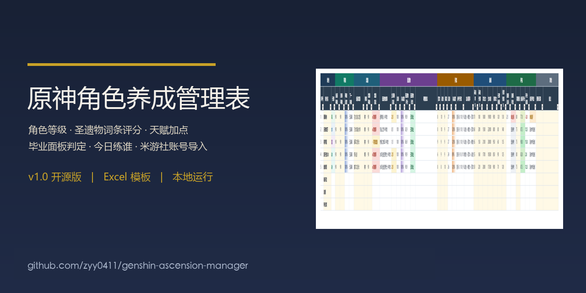
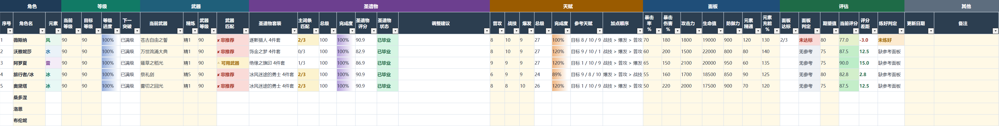
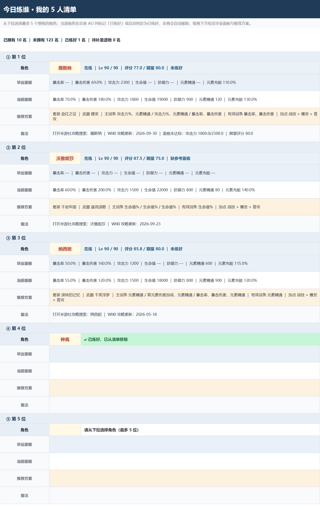
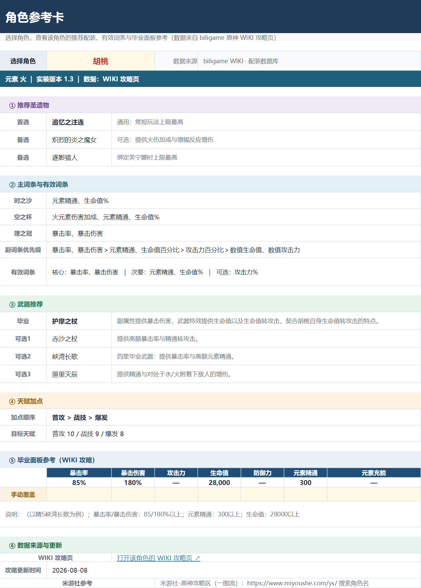
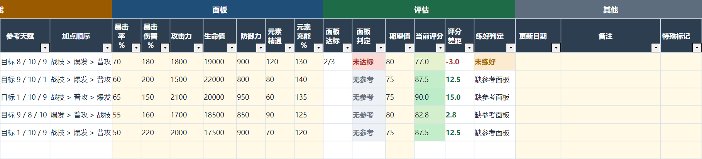
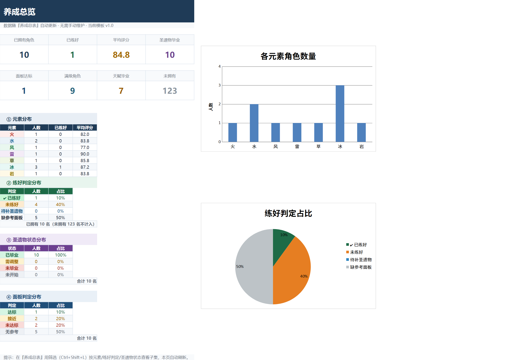
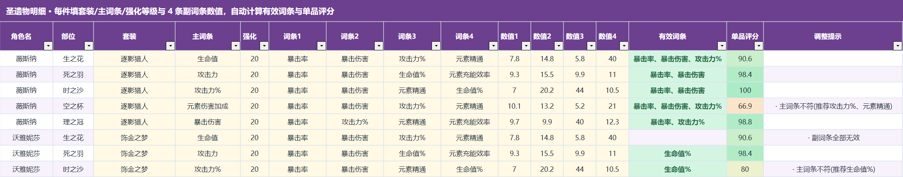

# 原神角色养成管理表 v1.0

一个 Excel 表格，管完角色等级、圣遗物词条评分、天赋和毕业面板；支持米游社账号本地导入。

    

**[下载 v1.0 完整包](https://github.com/zyy0411/genshin-ascension-manager/releases/latest) · [使用说明](docs/使用说明.md) · [更新与导入](docs/更新与导入.md)**

解压后直接用 Windows 桌面 Excel 打开根目录空白表，手动记录不需要 Python。没有宏，没有后台服务。

角色练到哪、装备怎么样，在同一张总表里看。截图为合成示例数据。

最多自选五人，查看当前面板、毕业参考与差距。

配装和天赋集中查看，参考面板支持手动覆盖。

## 它解决什么问题

- 角色太多记不住练度：133 个预置角色，一行一人，记录拥有状态、等级、武器、天赋与命座。
- 不知道圣遗物先换哪件：逐件填写词条，按角色 WIKI 优先级评分并给调整建议。
- 每天上线不知道练谁：自选五个目标，对照毕业参考补短板，已练好角色自动排除显示。

## 功能

| 功能 | 具体用途 |
|---|---|
| 全角色总表 | 快照预置 133 个角色及旅行者变体，标记已有或未拥有 |
| 装备与天赋 | 等级、武器、精炼、命座、三个战斗天赋统一记录 |
| 圣遗物明细 | 每人五件，主词条、强化及四条副词条逐件录入 |
| 词条评分 | 强化、主词条、有效副词条加权，并提示调整部位 |
| 毕业面板 | 对照 WIKI 参考；无参考会明确提示 |
| 今日练谁 | 五个自选槽位，显示面板缺口和推荐 |
| 参考卡与仪表盘 | 集中查攻略和拥有分布，可手动覆盖参考卡面板 |
| 本地导入与更新 | 可选 Python 脚本读取米游社数据、更新 WIKI 快照 |

## 5 分钟上手

1. 在 [Releases](https://github.com/zyy0411/genshin-ascension-manager/releases/latest) 下载 `原神角色养成管理表_v1.0.zip` 并完整解压。
2. 用 Excel 打开 `原神角色养成管理表_v1.0.xlsx`，启用自动计算。
3. 在养成总表把拥有状态改为已有，填写浅黄格；白格为受保护公式。
4. 在圣遗物明细填五件装备，在总表填当前面板，查看评分与缺口。
5. 在今日练谁选最多五人，保存个人副本。想先体验，可打开 `examples/示例数据_v1.0.xlsx`（合成数据）。

## 界面截图

面板与综合练度判定。

拥有角色、练好状态和元素分布。

逐件评分和调整提示，所有截图均为演示数据。

## 更新数据

Windows 自动化脚本需要 Python 3.9+，先运行 `py -3 -m pip install -r requirements.txt`。完整包附带全部源码与公开数据，无需另行寻找脚本。

**更新账号装备**：自行保存米游社 Cookie → 双击 `检查米游社Cookie.bat` → `导入米游社数据.bat` 生成个人副本。以后用 `更新我的数据.bat` 写回主表，自动备份。

**更新公开 WIKI**：双击 `更新数据.bat` 重新抓取配装与面板，备份后重建空白表。此操作会重置主表输入，请勿当作账号更新。离线重建可运行 `py -3 _source/update_data.py --offline`。

Cookie 和账号缓存仅在本机保存；Cookie 仅发给官方接口验证身份。请不要分享 Cookie、个人工作簿或 `_wiki_tmp/miyoushe/`。官方接口变化或风控可能导致导入失败。

## 文档

- [使用说明](docs/使用说明.md)：九张表、评分、面板和保护规则。
- [更新与导入](docs/更新与导入.md)：Python、Cookie、四个启动器及故障处理。
- [常见问题](docs/常见问题.md)：输入、评分、覆盖与兼容性。

## 版本记录

| 版本 | 变化 |
|---|---|
| v0.1 | 5 张表、93 角色手工配装库、基础评分 |
| v0.2 | 接入 WIKI、133 角色、参考卡、视觉减负 |
| v0.3 | 练度标记与今日练谁 |
| v0.4 | 圣遗物逐件评分、调整建议、毕业面板 |
| v0.4.1 | 修复套装下拉拼接 |
| v0.4.2 | 修复推荐显示与缺参考误判，米游社导入 |
| v0.5 | 全角色预置、拥有状态和命座、自选五人 |
| v0.6 | 公式锁定、下拉、更新、面板缺口、参考覆盖 |
| v1.0（2026-11-03） | 首个开源发布版，整理 Windows 启动、使用文档和下载包，保留现有养成功能 |

## 数据来源与许可

代码采用 [MIT](LICENSE)。角色、配装与面板来自 [biligame 原神 WIKI](https://wiki.biligame.com/ys/首页)，感谢旅行者酒馆和页面贡献者；相关数据按 CC BY-NC-SA 4.0 使用，详情见 [数据署名与许可](NOTICE-data.md)。游戏内容版权归 miHoYo 及相关权利人所有。代码 MIT 不表示第三方数据可以商业使用。

数据是交付快照，参考面板并不覆盖全部角色，也不保证实时完整。养成评分用于辅助记录，不等同于伤害计算。

## 常见问题

- **不装 Python 能用吗？** 能，直接手填 Excel；脚本导入和更新才需要。
- **公式不能改？** 默认锁定；审阅 → 撤销工作表保护，无密码。
- **怎么还没练好？** 核对武器、圣遗物、天赋与面板；缺参考不会误判为已练好。
- **更新会清空吗？** WIKI 更新重建空白表；账号更新只写游戏字段。两者都先备份，请分清入口。
- **数据安全吗？** 项目没有后端；个人 Cookie、缓存、备份留本机，请自行妥善保管并避免上传。

## Star / 贡献

用得顺手可以点个 Star，也欢迎通过 Issue 提交公式、数据解析或文档问题。反馈请用合成数据，隐去 UID、昵称与 Cookie。修改生成器请编辑 `_source/v4_*.py` 后运行 `py -3 _source/assemble_v4.py`；不要直接修改合并产物。离线检查：`py -3 -m unittest discover -s tests -v`。

---

非官方玩家工具，与 miHoYo 无隶属或背书关系。请遵守数据许可及官方协议，合理安排游戏时间。当前发布面向 Windows 桌面 Excel；Windows 启动器、真实账号导入及 Excel 实际计算结果仍需在目标环境验证。
