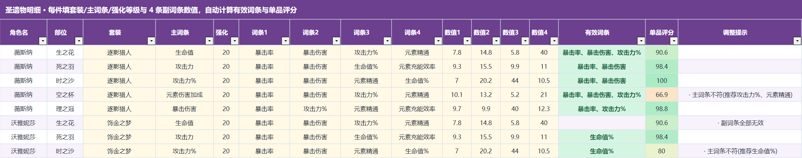

# 使用说明

## 开始记录

在 Windows 的 Microsoft Excel 打开根目录 `原神角色养成管理表_v1.0.xlsx`。表格本身不需要 Python，也没有宏。使用桌面版 Excel；其他表格软件的下拉、图表和公式兼容性请自行确认。首次打开允许公式自动计算，建议使用 Excel 自动计算模式。

浅黄格是输入；白格自动计算。工作表保护无密码，需要修改公式时可在“审阅 → 撤销工作表保护”解除；请先备份。不要删除预置角色行或移动公式列。

## 九张工作表

- **养成总表**：133 个预置角色（含旅行者变体），填写拥有状态、等级、武器、精炼、武器等级、天赋、命座和当前面板，自动显示差距和练好判定。先把已有角色的拥有状态改成“已有”；未拥有角色的评估显示为空。
- **今日练谁**：五个自选槽位 C7/C13/C19/C25/C31，选择想练的角色，查看毕业参考、当前面板和调整建议。已练好的角色会隐藏详细规划内容；选项单元格保留用户选择，重新选择即可更换。
- **圣遗物明细**：每人五件，共 665 行。填写套装、主词条、强化等级及四条副词条名称和数值，自动评分。
- **角色参考卡**：B4 选角色，集中查看推荐武器、套装、天赋及面板；B32:H32 可手动覆盖参考面板，手动值优先。其他视图仍以各自公式引用为准，覆盖并不写回数据库。
- **配装数据库**：WIKI 推荐的结构化快照，浅黄输入可以自行调整；修改后引用它的公式随之更新。
- **仪表盘**：拥有数量、练好人数、评分和元素分布，随总表计算。
- **数据源**：下拉菜单使用的角色、武器和词条等基础清单。
- **数据与更新**：数据来源、版本与更新入口。
- **使用说明**：工作簿内的简明规则。

## 圣遗物评分

单品评分（0–100）= 强化 25% + 主词条 20% + 有效副词条 55%。词条按 WIKI 优先级识别为核心、次要、可选；数值需按格内格式填写，例如暴击率 3.9，而不是 0.039。百分比项填显示的百分数，不额外输入百分号。

五件单品分的平均得到总评分，缺件会拉低总分：≥75 为已毕业；55≤评分<75 为需调整；<55 为未毕业。总表提示优先调整的低分部位。此分数是养成辅助参考，不等同于伤害模拟或通用圣遗物价值。

## 面板与练好判定

当前暴击率、暴击伤害、攻击、生命、防御、精通、充能填入总表 Z:AF。百分数填写如 85、180、130；其余填面板数值。面板尽量和参考条件一致，注意队伍增益、武器与命座差异。

逐项比较 WIKI 提供的有效参考：全部达标显示达标，命中比例≥70%显示接近，否则未达标；无参考显示无参考，综合判定会提示缺参考面板，不会自动当作已练好。参考覆盖数量以“数据与更新”为准。

综合评分权重：等级 15%、武器匹配 10%、武器等级 10%、圣遗物 35%、天赋 15%、面板 15%。自动练好判定要求武器等级与匹配、五件圣遗物及评分、天赋和面板均符合条件；以工作簿公式结果为准。特殊标记可手动设为已练好、暂缓或不练了。

## 建议操作顺序

1. 在总表标记已有角色，填等级、武器和天赋。
2. 到圣遗物明细录入五件装备，检查副词条名称和数值。
3. 填当前面板，核对参考卡和总表差距。
4. 在今日练谁选择最多五人，按建议补短板。
5. 保存个人副本；后续数据更新前关闭 Excel 并备份。

